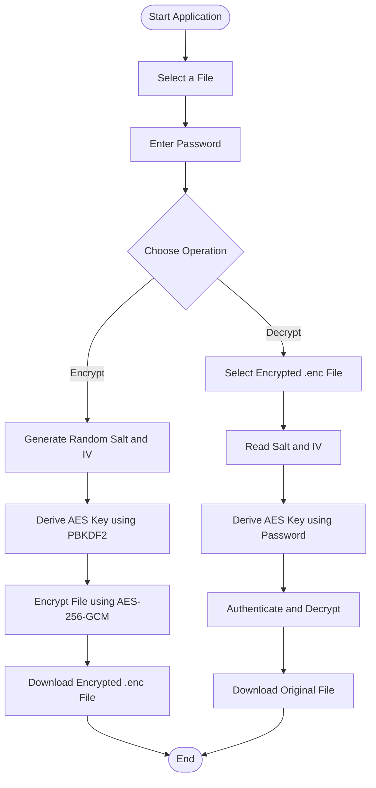

# 🔐 Vault – File Encryption and Decryption System

A browser-based file encryption and decryption application that helps protect files using password-based encryption. Built with **HTML, CSS, JavaScript, and the Web Crypto API**, this project uses AES-256-GCM encryption and PBKDF2 key derivation.

<p align="center">
  <a href="https://iamveerpratapsingh07-eng.github.io/File-Encryption-and-Decryption-System/">
    <strong>🚀 Live Demo</strong>
  </a>
</p>

---

## 📌 About the Project

Vault is a web application designed to demonstrate how cryptography can be used to protect digital files.

Users can select a file, enter a password, and encrypt it directly in their browser. The encrypted file can later be decrypted using the same password.

The application performs file processing locally in the browser, without uploading file contents to a backend server.

## ✨ Features

- 🔒 Encrypt files using AES-256-GCM.
- 🔓 Decrypt previously encrypted `.enc` files.
- 🔑 Password-based key derivation using PBKDF2.
- 🛡️ Authentication to detect incorrect passwords or modified encrypted data.
- 🎲 Random salt and initialization vector for every encryption.
- 📁 Supports different file types.
- 🖥️ Simple and responsive user interface.
- 🌐 Browser-based application with no backend required.

## 🖼️ Screenshots

### 1. Home Screen


### 2. File Encryption


### 3. Encryption Successful


### 4. Decryption Successful


## 🔄 Application Workflow



## 🛠️ Technologies Used

| Technology | Purpose |
|---|---|
| HTML5 | Application structure |
| CSS3 | Styling and responsive interface |
| JavaScript | Application logic |
| Web Crypto API | Cryptographic operations |
| AES-256-GCM | File encryption and authentication |
| PBKDF2 | Password-based key derivation |
| GitHub Pages | Project deployment |
| Git & GitHub | Version control and hosting |

## 🔐 Encryption Details

The application uses the following cryptographic components:

| Component | Configuration |
|---|---|
| Encryption algorithm | AES-256-GCM |
| Key derivation | PBKDF2 |
| Hash function | SHA-256 |
| PBKDF2 iterations | 200,000 |
| Salt size | 16 bytes |
| Initialization vector | 12 bytes |
| Encryption key size | 256 bits |

### How Encryption Works

1. The user selects a file and enters a password.
2. The application generates a random salt and initialization vector.
3. PBKDF2 derives a 256-bit encryption key from the password.
4. AES-256-GCM encrypts the selected file.
5. The encrypted file is generated with the required metadata.

### How Decryption Works

1. The user selects the encrypted `.enc` file.
2. The application reads the stored salt and initialization vector.
3. PBKDF2 derives the encryption key using the entered password.
4. AES-GCM verifies the authentication tag and decrypts the data.
5. If authentication succeeds, the decrypted file is downloaded.

## 📂 Project Structure

```text
File-Encryption-and-Decryption-System/
│
├── Screenshots/
│   ├── home screen.png
│   ├── encrypt file.png
│   ├── encryption sucessful.png
│   └── decrypted successfully .png
│
├── index.html
├── README.md
├── .gitignore
└── LICENSE
```

## 🚀 How to Run Locally

### Prerequisites

- A modern web browser.
- Visual Studio Code (recommended).
- Live Server extension or Python installed.

### Steps

1. Clone the repository:

```bash
git clone https://github.com/iamveerpratapsingh07-eng/File-Encryption-and-Decryption-System.git
```

2. Open the project folder in Visual Studio Code.

3. Start a local server.

Using Python:

```bash
python -m http.server 8000
```

4. Open the following address in your browser:

```text
http://localhost:8000
```

Alternatively, right-click `index.html` in VS Code and select **Open with Live Server**.

## ⚠️ Security Notes and Limitations

- Keep your encryption password safe. There is no password recovery mechanism.
- Use a strong, unique password.
- File contents are processed locally in the browser.
- Very large files may require substantial browser memory.
- This is an educational project and has not undergone a professional security audit.
- Keep an unencrypted backup until you have successfully tested decryption.

## 🔮 Future Enhancements

- Support for large files through chunk-based processing.
- Batch file encryption and decryption.
- Improved interface and accessibility.
- Automated testing for encryption and decryption.
- Optional desktop application version.

## 🎯 Learning Outcomes

Through this project, I explored:

- Practical implementation of cryptographic algorithms.
- Password-based key derivation.
- Secure file handling using JavaScript.
- Browser-based cryptographic operations.
- Frontend development and responsive design.
- Project deployment using GitHub Pages.
- Version control using Git and GitHub.

## 👨‍💻 Author

**Veer Pratap Singh**

B.Tech – Computer Science and Engineering

- GitHub: [iamveerpratapsingh07-eng](https://github.com/iamveerpratapsingh07-eng)
- Project Repository: [File Encryption and Decryption System](https://github.com/iamveerpratapsingh07-eng/File-Encryption-and-Decryption-System)
- Live Demo: [Open Application](https://iamveerpratapsingh07-eng.github.io/File-Encryption-and-Decryption-System/)

## 📄 License

This project is licensed under the MIT License. See the [LICENSE](LICENSE) file for details.
